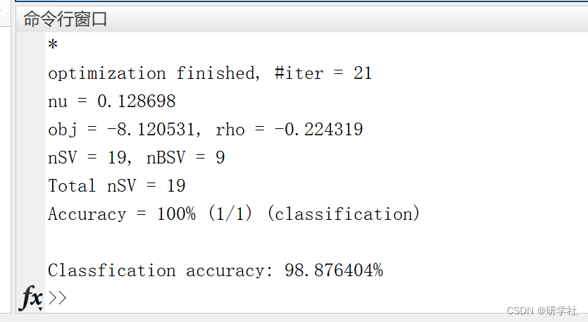

# SVM and Radial Basis Function (MDRBF) kernel combination based on Mahalanobis distance (Matlab code implementation)

🏆 Bloggers' Advantage: 🌞🌞🌞 The content of the blog is as thorough and logical as possible to facilitate readers.
⛳️ Mantra: "A hundred miles are half a mile when you run it."
📋📋📋 This article's outline is as follows: 🎁🎁🎁 Outline💥1 Overview📚2 Running Results🎉3 References🌈4 MATLAB Code Implementation
​Edit💥1 Overview The idea of measuring learning and supporting vector machine (SVM) has been mutually learned in many recent works. The classification tools obtained from SVM algorithms have many advantages, including the largest margin and kernel tricks. Meanwhile, the measurement learning algorithm can obtain a Mahalanobis distance function that emphasizes relevant features and reduces the impact of non-informative features. The combination of these two methods, called SVM with a Mahalanobis distance-based Radial Basis Function (MDRBF) kernel, seems to be a good solution for most classification problems. This paper's algorithm learns a Mahalanobis distance kernel for Support Vector Machine classification. Jiangyuan Mei, Xiianqiang Yang, and Huijun Gao, Learning a Mahalanobis distance kernel for Support Vector Machine classification, Journal of The Franklin Institute, in review.📚2 Running Results
Part of the code:
disp('Cross-validating....')  
for cross=1:k_fold  
%% crossvalidation  
disp(sprintf('\nFold %d', cross));  
test_start = ceil(n_samples/k_fold * (cross-1)) + 1;
test_end = ceil(n_samples/k_fold * cross);  
Y_train = [];  
X_train = zeros(0, n_features);  
if (cross > 1);  
Y_train = Y_index(1:test_start-1);  
X_train = X(1:test_start-1,:);  
end  
if (cross < k_fold),  
Y_train = [Y_train; Y_index(test_end+1:n_samples)];  
X_train = [X_train; X(test_end+1:n_samples, :)];  
end  
X_test = X(test_start:test_end, :);  
Y_test = Y_index(test_start:test_end);  
[X_train,Y_train]=data_rank(X_train,Y_train);  
[M_struct,SVM_model_struct]=DAGSVMMDRBF_train(X_train,Y_train);  
Predict=DAGSVMMDRBF_predict(M_struct,SVM_model_struct,X_train,Y_train,X_test,Y_test);  
Predict_all(test_start:test_end,1)=Predict;  
end  
accuracy = sum(Predict_all == Y_index) / n_samples * 100;  
disp(sprintf('\nClassification accuracy: %f%%', accuracy));  
🎉3 References  
🌈4 Matlab code implementation

## Images

<!-- PAYMENT_BLOCK -->

## Get this dataset

- Payment link (Stripe): [Buy now](https://buy.stripe.com/3cs8yP7sY87d0vu9AB)
- Payment QR code: 

<!-- /PAYMENT_BLOCK -->
